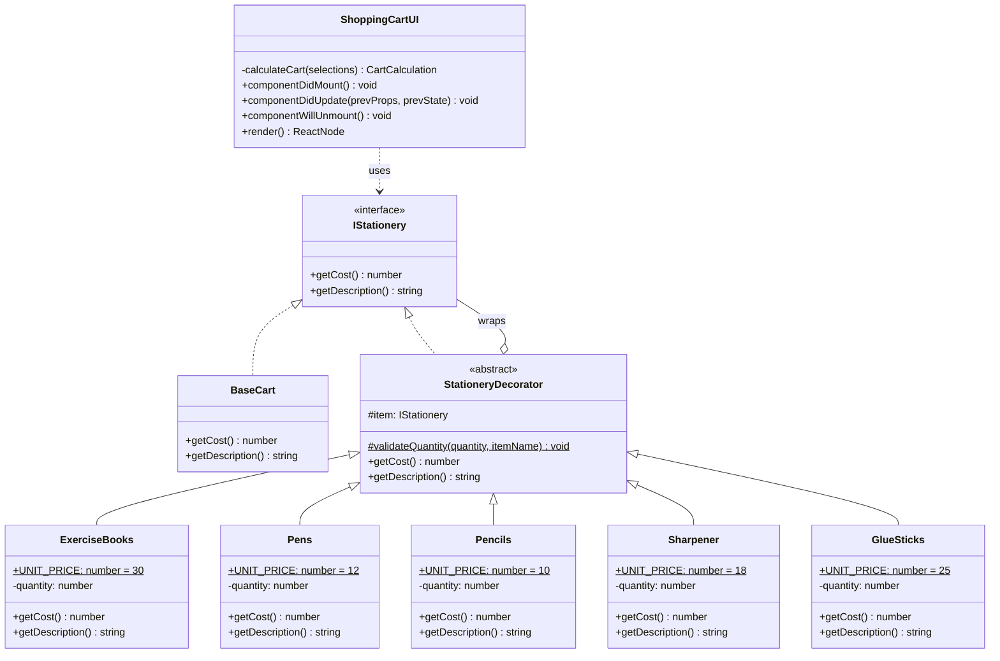

# Weekly Checkpoint 3 – Stationery Shopping Cart (Decorator Pattern)

**Author:** Samika Perera
**Date:** 3 November 2026
**Tech:** React 19 + TypeScript + Vite 6

**GitHub repository:** https://github.com/SamikaPerera/weekly-checkpoint3

---

## 1. Project description

A shopping cart for a stationery shop. All prices are in NZD per unit:

| Item           | Unit price (NZD) |
| -------------- | ---------------- |
| Exercise Books | $30.00           |
| Pens           | $12.00           |
| Pencils        | $10.00           |
| Sharpener      | $18.00           |
| Glue Sticks    | $25.00           |

How it works:

1. Tick an item's checkbox. This enables its quantity dropdown (1–10).
2. Choose a quantity.
3. Click **Display Total Cost** to see the total (for example `Total Cost: $66.00 NZD`) and what is in the cart.
4. After that first click, the total **updates straight away** whenever you tick or untick an item or change a quantity.
5. If nothing is selected, a message asks you to tick at least one item.

The total is never added up directly in the UI. It always comes from a chain of **decorator** objects.

---

## 2. The Decorator design pattern

The **Decorator** pattern is a structural design pattern. It lets you add behaviour to an object at runtime by wrapping it inside other objects that share its interface. Each wrapper (decorator) passes the call to the object it wraps, then adds its own behaviour to the result.

In this app, an empty cart gets wrapped once for each selected item. Each wrapper adds its line cost and its description:

```ts
let cart: IStationery = new BaseCart(); // $0,  "Cart"
cart = new Pens(cart, 3);               // $36, "Cart, Pens x 3"
cart = new Pencils(cart, 3);            // $66, "Cart, Pens x 3, Pencils x 3"

cart.getCost();        // 66
cart.getDescription(); // "Cart, Pens x 3, Pencils x 3"
```

### Why use Decorator here?

- **Open/Closed principle:** to add a new product, write one new decorator class and add one entry to `src/constants/items.ts`. No existing class needs to change.
- **Single source of truth for prices:** each price is defined once, as the decorator's `public static readonly UNIT_PRICE`. The item list reads it (e.g. `price: Pens.UNIT_PRICE`) rather than repeating the number.
- **Any combination at runtime:** the customer can choose any mix of items without a separate subclass for every combination.
- **Single responsibility:** each class knows only its own price and label.

### How each class fits

| Pattern role           | Class / file                                                       | Responsibility                                                                                                   |
| ---------------------- | ------------------------------------------------------------------ | ---------------------------------------------------------------------------------------------------------------- |
| **Component**          | `IStationery` (`src/models/IStationery.ts`)                        | Interface declaring `getCost(): number` and `getDescription(): string`.                                          |
| **Concrete Component** | `BaseCart` (`src/models/BaseCart.ts`)                              | The empty cart. `getCost()` returns `0`, `getDescription()` returns `"Cart"`.                                    |
| **Abstract Decorator** | `StationeryDecorator` (`src/models/StationeryDecorator.ts`)        | Implements `IStationery`, holds the wrapped object in `protected readonly item`, passes calls through to it, and validates quantities. |
| **Concrete Decorator** | `ExerciseBooks`, `Pens`, `Pencils`, `Sharpener`, `GlueSticks`      | Each has a `public static readonly UNIT_PRICE` (the single source of truth for its price; `items.ts` reads it). `getCost()` = `item.getCost() + UNIT_PRICE * quantity`. `getDescription()` adds `", <Name> x <qty>"`. |
| **Client**             | `ShoppingCartUI` (`src/components/ShoppingCartUI.tsx`)             | React class component that builds the decorator chain from the user's choices and shows the result.               |

### Class diagram



Plain-text version:

```
                 «interface»
                 IStationery
           + getCost(): number
           + getDescription(): string
                 ▲          ▲
     implements  │          │  implements
                 │          │
           BaseCart    «abstract» StationeryDecorator ◇──── wraps ───► IStationery
                        # item: IStationery
                                 ▲
                 ┌────────┬──────┴──┬───────────┬────────────┐
           ExerciseBooks  Pens    Pencils    Sharpener   GlueSticks
              ($30)      ($12)    ($10)       ($18)        ($25)
```

### How the React class lifecycle is used (`ShoppingCartUI`)

| Lifecycle method                         | What it does                                                                                                                         |
| ---------------------------------------- | ------------------------------------------------------------------------------------------------------------------------------------ |
| `constructor`                            | Sets the initial state: nothing ticked, every quantity set to 1, total hidden.                                                       |
| `componentDidMount`                      | Sets the browser tab title and logs that the cart is ready.                                                                          |
| `componentDidUpdate(prevProps, prevState)` | If the total is already showing and `selections` has changed, recalculates the total. This gives the live update when items change. |
| `componentWillUnmount`                   | Puts the original tab title back and logs the cleanup.                                                                               |

---

## 3. Folder structure

```
weekly-checkpoint3/
├── index.html
├── package.json
├── README.md
├── tsconfig*.json
├── vite.config.ts
└── src/
    ├── main.tsx                     # Entry point – mounts <App />
    ├── App.tsx                      # Root component – renders <ShoppingCartUI />
    ├── App.css                      # Cart styling
    ├── index.css                    # Global base styles
    ├── components/
    │   └── ShoppingCartUI.tsx       # React class component (Client)
    ├── constants/
    │   └── items.ts                 # Item list: id, name, price, decorator class
    ├── models/
    │   ├── IStationery.ts           # Component interface
    │   ├── BaseCart.ts              # Concrete component
    │   ├── StationeryDecorator.ts   # Abstract decorator
    │   ├── ExerciseBooks.ts         # Concrete decorator ($30)
    │   ├── Pens.ts                  # Concrete decorator ($12)
    │   ├── Pencils.ts               # Concrete decorator ($10)
    │   ├── Sharpener.ts             # Concrete decorator ($18)
    │   ├── GlueSticks.ts            # Concrete decorator ($25)
    │   └── index.ts                 # Re-exports all models
    └── utils/
        └── currency.ts              # NZD currency formatter
```

---

## 4. How to run

Requirements: Node.js 18+ (tested with Node 20.15) and npm.

```bash
npm install      # install dependencies
npm run dev      # start the dev server, then open the URL shown (usually http://localhost:5173)
```

Other scripts:

```bash
npm run build    # type-check and build for production (output in dist/)
npm run lint     # run ESLint
npm run preview  # serve the production build locally
```

---

## 5. Example outputs

| Selection                         | Displayed result                                                                    |
| --------------------------------- | ----------------------------------------------------------------------------------- |
| Nothing ticked                    | "Your cart is empty. Tick at least one item to see the total cost."                 |
| Pens x 3                          | `Total Cost: $36.00 NZD` – Cart, Pens x 3                                           |
| Pens x 3, Pencils x 3             | `Total Cost: $66.00 NZD` – Cart, Pens x 3, Pencils x 3                              |
| One of every item                 | `Total Cost: $95.00 NZD` – Cart, Exercise Books x 1, Pens x 1, Pencils x 1, Sharpener x 1, Glue Sticks x 1 |
